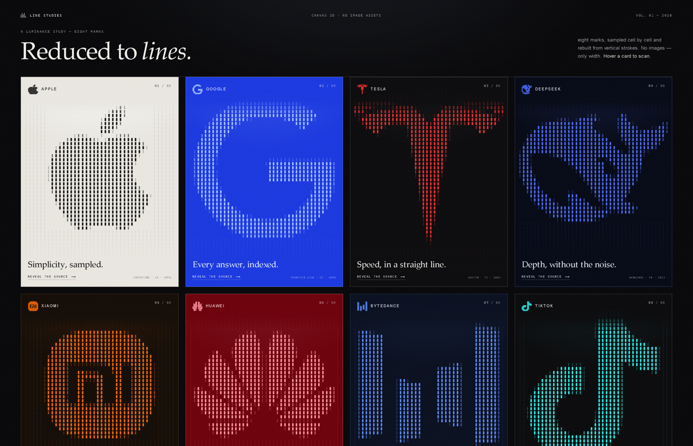

# brand-lines

Turn brand logos into a **luminance study**: each mark is sampled into a brightness
table once, then redrawn every frame as bamboo-like vertical strokes whose width
encodes brightness.



One self-contained HTML file. No libraries, no image assets, no network requests.

## What it does

- **Samples, does not trace.** The SVG path is drawn once into an offscreen canvas,
  averaged into a 64×64 (or 96×96) brightness table, and the canvas is released.
- **Encodes brightness as stroke width.** Four discrete width classes, so the
  strokes read as bamboo joints rather than a smooth gradient.
- **Keeps the knockouts open.** Noise is gated by the sampled tone, and dark cells
  inside the mark draw nothing — otherwise a solid mark's counter fills in.
- **Frames follow the ink.** A wide mark (Huawei 1.33:1, DeepSeek 1.36:1) gets a
  wide frame instead of being squeezed into a square.
- **Equalises ink weight**, not frame size, so a dense mark (Xiaomi, 52% coverage)
  does not read as twice the size of a sparse one (Tesla, 18%).
- **Scans on hover.** Pointer movement sends an outward impulse through nearby
  strokes, springs pull them home, and grid-snapped detection boxes appear over the
  mark's brightest regions.

## Usage

```bash
cd scripts
npm install                      # only needed for diagnose
npx playwright install chromium

node build.mjs --config ../assets/brands.json --out ../out/index.html
node build.mjs --config ../assets/brands.json --single apple --out ../out/apple.html
node diagnose.mjs --html ../out/index.html --out ../out/quality.json
```

`build.mjs` validates every brand and fails loudly on a missing field, an illegal
path character, or path coordinates outside a 24-unit box — the last case used to
build "successfully" into a blank card.

`diagnose.mjs` runs the real page headless and writes `quality.json`: per-brand
sampling grid, thinnest stroke and gap, whether both survive the grid, ink
coverage, stroke counts; plus p50/p95 frame time, viewport, DPR and GPU renderer.
Its verdict requires **both** percentiles inside budget.

## Adding a brand

Add an entry to `assets/brands.json`:

```jsonc
{
  "id": "acme",
  "name": "Acme",
  "tagline": "One line does it.",
  "meta": "Somewhere · 20XX",
  "path": "M12 …",              // 24×24 coordinate system
  "palette": {
    "bg": "#101014", "bgRgb": "16 16 20", "ink": "#f2f2ee",
    "line": "#7ee0ff", "scan": "#ffd166", "scanInk": "#1a1200",
    "edge": "rgba(255,255,255,.16)", "glow": "rgba(255,255,255,.08)"
  }
}
```

`scanInk` is the text colour *on* a filled detection chip — it must contrast with
`scan`, not with `bg`. That pair is the most common way a chip ends up invisible.

## When the encoding fails

It is an encoding, not a filter. A mark only survives if its strokes **and** its
counters survive the grid.

| Mark | Symptom | What to do |
| --- | --- | --- |
| Hairline strokes | vanish | finer grid, or widen `line` |
| Solid mark with a counter | counter fills in | keep knockouts empty, gate noise by tone |
| Wide mark | shrunk in a square | frame follows ink aspect |
| Long tapering tail | tip cropped | low crop threshold + padding |
| Mark with no vertical structure | reads as a bar chart | say so; it is a property of the source |
| Mostly text | letters turn to mush | keep the type as type |

The last one is real: ByteDance's mark is four solid bars with 162 vertical
structural transitions, against 262 for Apple and 604 for Huawei. There is no
horizontal detail to encode. That belongs in the delivery note, not in a parameter
tweak.

## Performance

Measured on Chrome/ANGLE, RTX 3060 Laptop, 1600×950, 8 cards:

| configuration | p50 | p95 |
| --- | --- | --- |
| per-segment `stroke()` + round cap | 133 ms | — |
| batched `roundRect` fill, DPR 2, no budget | 63.6 ms | — |
| + pixel budget + staggered idle redraw | **16.7 ms** | **18.7 ms** |

The 6× jump between rows 1 and 2 is why the batching is a hard constraint rather
than a preference. `npm run diagnose` reproduces the numbers on your machine.

## Licence and trademarks

Code and text: MIT (see `LICENSE`).

The bundled marks are trademarks of their respective owners — Apple, Google,
Tesla, DeepSeek, Xiaomi, Huawei, ByteDance and TikTok. Their vector paths come
from the [Simple Icons](https://simpleicons.org) project (CC0 for the path data;
the marks themselves remain the property of their owners). They are included as
demonstration data for the renderer, not as a statement of affiliation or
endorsement. Replace `assets/brands.json` with your own marks for production use.
