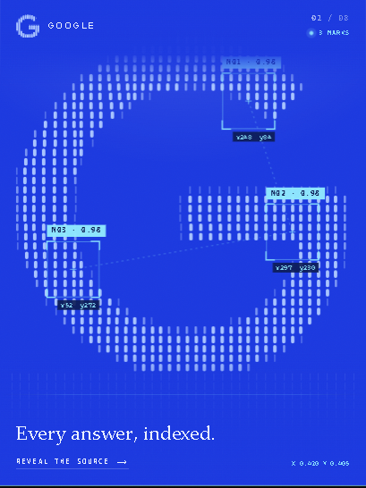
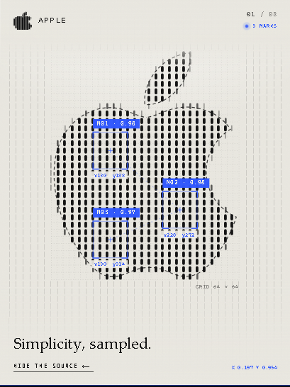

# baixiao-brand-lines

把品牌 logo 变成一幅**亮度研究**：每个标志先被采样成一张亮度表，之后每一帧都用竖线重画，线宽由亮度决定。


一个自包含的 HTML 文件。无第三方库、无图片素材、无任何网络请求。

---

## 它在做什么

不是描摹，是**编码**。logo 只被绘制一次，之后所有帧都在查表。

| 步骤 | 做法 |
| --- | --- |
| 1. 采样 | SVG path 画进离屏 canvas，按 64×64（必要时 96×96）网格求每格平均 alpha，存成 `Float32Array`，随后把 canvas 宽高置 0 释放 |
| 2. 编码 | 约 40 根等距竖线，每根切 ~53 段逐段查表，亮度量化成 **4 档线宽**，圆角矩形批量填充 |
| 3. 呼吸 | 亮度表上叠 32×32 value noise 缓慢下移，鼠标不碰时线也在轻轻浮动 |
| 4. 交互 | 指针移动给附近线一个向外冲量，弹簧拉回；最亮的 3 个区域生成检测框，吸附到「线距 × 段高」网格，带角标、置信度、坐标、虚线连接 |
| 5. 高清 | canvas 尺寸乘 devicePixelRatio，坐标按设备像素取整 |

### 扫描：检测框吸附到采样网格

<p align="center">
  
</p>

检测框的位置不是手写的，是从亮度表里 8×8 分块找最亮的三个再吸附到网格，所以框一定落在竖线的节拍上。`M01 · 0.98` 里的置信度也是算出来的。

### 显示源图：叠回原始矢量轮廓

<p align="center">
  
</p>

点「Reveal the source」会叠出原始 SVG 轮廓和采样网格。右下角标注的 `GRID 64 × 64` 是这张卡实际使用的采样分辨率。

---

## 三个让它成立的细节

这些不是可选的优化，缺了任何一个，画面就会散掉。

**1. 按线宽分组批量填充，绝不逐段描边**

逐段 `stroke()` + 圆头端点，三张卡每帧要 **133ms**；改成按 4 档线宽分组、每档一个 `Path2D`、`roundRect` 批量 `fill()`，降到 **18ms**。差 6 倍。这是架构决策，不是优化技巧——按直觉实现的人一定会踩。

**2. 镂空必须留空**

实心标志的辨识度全在内部的孔里：小米的 `mi`、华为的花瓣间隙。两条规则保住它：

```js
// 噪声按采样亮度加权，绝不填满孔洞
b = base + noise * 0.235 * smooth(clamp(base * 3, 0, 1));

// 标志内部的暗格是真孔，什么都不画，让卡片底色透出来
if (level === 0 && !outside) continue;
```

没有这两行，小米会糊成一块橙色方块。

**3. 画框跟随墨迹，也平衡墨量**

方形画框会把横向标志压扁：华为宽高比 1.33、DeepSeek 1.36，塞进正方形要缩掉三分之一。

更隐蔽的是**墨量差异**：同样大的画框，小米覆盖率 52%、特斯拉 18%，视觉上小米会像大了一倍。实测两排墨量差 25%，评审看截图时说的是「第二排偏大 12-15%」，但每张画框其实一样大。

修正用 `k = sqrt(REF / coverage)` 均衡墨量而不是尺寸，两排墨量比从 1.25 降到 1.08。

---

## 快速开始

```bash
git clone https://github.com/csuyincs-creator/baixiao-brand-lines.git
cd baixiao-brand-lines/scripts
npm install                       # 仅 diagnose 需要
npx playwright install chromium

node build.mjs --config ../assets/brands.json --out ../out/index.html
node build.mjs --config ../assets/brands.json --single apple --out ../out/apple.html
node diagnose.mjs --html ../out/index.html --out ../out/quality.json
```

打开 `out/index.html` 即可。`--single <id>` 会切到单品牌大画幅版式。

### diagnose 输出什么

`quality.json` 记录每个品牌的采样网格、最细笔画与最窄间隙（单位：探针像素）、这两者是否都还撑得住网格、墨量覆盖率、笔画数量、检测框数量；以及整页的 p50 / p95 帧耗时、视口、DPR、GPU 型号。

判定要求 **p50 和 p95 同时达标**才算 `at-budget`。只看 p50 会把卡顿判成通过——这是我实际踩过的坑。

本机实测（Chrome/ANGLE，RTX 3060 Laptop，1600×950，8 张卡）：**p50 16.7ms，p95 18.7ms**。

---

## 加一个品牌

编辑 `assets/brands.json`：

```jsonc
{
  "id": "acme",
  "name": "Acme",
  "tagline": "One line does it.",
  "meta": "Somewhere · 20XX",
  "path": "M12 …",                   // 必须是 24×24 坐标系
  "palette": {
    "bg": "#101014",                 // 卡片底色
    "bgRgb": "16 16 20",             // 同上，供 rgb(var(--bg-rgb) / .9) 用，必须一致
    "ink": "#f2f2ee",                // 文字
    "line": "#7ee0ff",               // 竖线
    "scan": "#ffd166",               // 检测框、坐标
    "scanInk": "#1a1200",            // 检测框上的文字，要和 scan 对比而不是和 bg
    "edge": "rgba(255,255,255,.16)", // 边框
    "glow": "rgba(255,255,255,.08)"  // 顶部辉光
  }
}
```

两个最容易搞错的字段：`bgRgb` 必须和 `bg` 是同一个颜色（遮罩靠它渐隐，偏了会出现一条可见横带）；`scanInk` 要对比 `scan` 而不是 `bg`（否则检测框底色和文字同色，标签是空的看不见）。

构建器会拦截三类错误：字段缺失、path 含非法字符、坐标超出 24 单位范围。最后一条以前会「成功」构建出一张空白卡——现在直接报错并告诉你实际坐标（例如 `reaches 331.3 units`）。

---

## 什么时候这套编码会失效

它是编码，不是滤镜。标志要活下来，笔画**和**镂空都得撑过网格。

| 标志类型 | 症状 | 处理 |
| --- | --- | --- |
| 极细笔画 | 采样后消失 | 提高网格到 96，或加粗 `line` |
| 实心带孔（小米） | 孔被填死 | 孔内不画线，噪声按亮度加权 |
| 横向标志（华为、DeepSeek） | 方形框内被缩小 | 画框跟随墨迹宽高比 |
| 长渐隐尾（TikTok） | 尾尖被裁 | 裁剪阈值降到 0.012 + 半格留白 |
| 几乎没有竖向结构 | 看起来像柱状图 | 如实说明，这是源文件的属性 |
| 以文字为主的标志 | 字形糊成一团 | 只做图标，文字保留为文字 |

最后一条是真实的：字节跳动那个标志是四根全高实心竖条，竖向结构变化只有 **162 次**，而苹果 262、华为 604。它没有横向细节可供编码。这种情况应该写进交付说明，而不是调参数把它「调得」更复杂。

---

## 目录结构

```
baixiao-brand-lines/
├── SKILL.md                  Agent Skill 定义（输入/输出/硬约束）
├── assets/
│   ├── template.html         渲染器；占位符由 build.mjs 注入
│   └── brands.json           八个示例品牌
├── scripts/
│   ├── build.mjs             配置 → 单文件 HTML
│   ├── diagnose.mjs          跑真实页面，输出 quality.json
│   └── package.json
├── reference/
│   ├── encoding.md           为什么是 4 档、阈值怎么来的、性能数据
│   └── palettes.md           八套配色与复用规则
└── docs/                     README 配图
```

---

## 许可证与商标

代码与文档：**MIT**（见 `LICENSE`）。

随附的八个标志是各自所有者的商标，仅作为**演示数据**收录，用于展示不同密度、宽高比、结构的标志在同一编码下的表现。不构成任何关联或背书。MIT 只覆盖本仓库的代码，不授予商标使用权。详见 `NOTICE.md`。

生产使用请替换 `assets/brands.json` 为你自己的标志。
